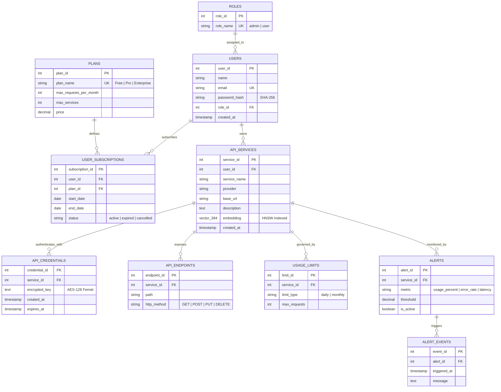

# API Pulse: Centralized Multi-Tenant API Observability & Gateway Platform
## DBMS Mini Project Comprehensive Academic Report

---

### Project Metadata
- **Project Title**: API Pulse: Centralized API Monitoring, Observability, and Gateway Platform
- **Architecture**: Polyglot Persistence (PostgreSQL 16 with pgvector + MongoDB 7 + FastAPI)
- **Primary Domain**: Database Management Systems (DBMS), Relational Modeling, NoSQL Analytics, Cryptography
- **Repository**: [https://github.com/ds610/api-pulse-DBMS-mini-project](https://github.com/ds610/api-pulse-DBMS-mini-project)

---

## 1. Problem Statement & Motivation

Modern software architectures rely extensively on third-party APIs (Stripe for payment processing, Twilio for telecommunications, OpenAI for artificial intelligence, SendGrid for transactional emails, etc.). Developers face **dashboard fragmentation**:
- Disjointed metrics across multiple provider consoles.
- Inability to enforce uniform organization-level rate limits.
- Difficulties discovering internal/external APIs using natural language.
- Security risks from unencrypted API keys stored in plaintext application files.

**API Pulse** solves this by providing a unified, centralized API Gateway and Observability platform that logs, monitors, secures, and semantically discovers APIs in real time.

---

## 2. Technology Justification: Why Polyglot Persistence?

Instead of forcing a single database engine into antipatterns, API Pulse applies **Polyglot Persistence**:

| Database | Data Stored | Technical Justification |
| :--- | :--- | :--- |
| **PostgreSQL 16** | Users, Roles, Plans, Subscriptions, Services, Endpoints, Limits, Alerts | **ACID Compliance & Relational Integrity**: Needs foreign keys, cascading deletes, unique constraints, and check constraints to prevent invalid billing/quota states. |
| **PostgreSQL + pgvector** | 384-dimensional dense semantic embeddings | **Co-located Vector Search**: Vectors live alongside relational service metadata. Uses **HNSW cosine index (`<=>`)**, eliminating external vector DB network latency. |
| **MongoDB 7** | High-volume request logs (`api_logs`) | **High Write Throughput & Append-Only Logs**: Fast writes without relational table locks. Dynamic schema allows arbitrary HTTP headers and fast `$percentile` approximation for p95 latency. |
| **Python (FastAPI)** | Reverse Proxy & Cross-Database Join | Bridges relational quotas in Postgres with runtime traffic aggregates in MongoDB. |

---

## 3. Entity-Relationship (ER) Diagram



---

## 4. Relational Schema Mapping & Integrity Constraints

1. **`roles`** (`role_id` [PK], `role_name` [UNIQUE, CHECK: admin, user])
2. **`users`** (`user_id` [PK], `name`, `email` [UNIQUE], `password_hash`, `role_id` [FK &rarr; roles.role_id], `created_at`)
3. **`plans`** (`plan_id` [PK], `plan_name` [UNIQUE], `max_requests_per_month` [CHECK > 0], `max_services` [CHECK > 0], `price` [CHECK &ge; 0])
4. **`user_subscriptions`** (`subscription_id` [PK], `user_id` [FK &rarr; users.user_id ON DELETE CASCADE], `plan_id` [FK &rarr; plans.plan_id], `start_date`, `end_date`, `status` [CHECK: active, expired, cancelled], CHECK: `end_date IS NULL OR end_date >= start_date`)
5. **`api_services`** (`service_id` [PK], `user_id` [FK &rarr; users.user_id ON DELETE CASCADE], `service_name`, `provider`, `base_url`, `description`, `embedding` [vector(384)], `created_at`, UNIQUE(`user_id`, `service_name`))
6. **`api_credentials`** (`credential_id` [PK], `service_id` [FK &rarr; api_services.service_id ON DELETE CASCADE], `encrypted_key`, `created_at`, `expires_at`)
7. **`api_endpoints`** (`endpoint_id` [PK], `service_id` [FK &rarr; api_services.service_id ON DELETE CASCADE], `path`, `http_method` [CHECK: GET, POST, PUT, PATCH, DELETE], UNIQUE(`service_id`, `path`, `http_method`))
8. **`usage_limits`** (`limit_id` [PK], `service_id` [FK &rarr; api_services.service_id ON DELETE CASCADE], `limit_type` [CHECK: daily, monthly], `max_requests` [CHECK > 0], UNIQUE(`service_id`, `limit_type`))
9. **`alerts`** (`alert_id` [PK], `service_id` [FK &rarr; api_services.service_id ON DELETE CASCADE], `metric` [CHECK: usage_percent, error_rate, latency], `threshold` [CHECK > 0], `is_active`)
10. **`alert_events`** (`event_id` [PK], `alert_id` [FK &rarr; alerts.alert_id ON DELETE CASCADE], `triggered_at`, `message`)

---

## 5. Formal Normalization Analysis (1NF, 2NF, 3NF, BCNF)

### 1NF (First Normal Form)
- **Criterion**: All attribute values are atomic; no repeating groups or multivalued columns.
- **Proof**: Every column contains single scalar values. Contact details, roles, and endpoints are separated into individual tables rather than comma-separated lists.

### 2NF (Second Normal Form)
- **Criterion**: In 1NF and no non-prime attribute is partially dependent on any candidate key (applies to composite keys).
- **Proof**: Tables with composite alternate keys (`api_services` on `(user_id, service_name)`, `api_endpoints` on `(service_id, path, http_method)`) use synthetic surrogate primary keys (`service_id`, `endpoint_id`), and all non-key columns depend on the full surrogate key.

### 3NF (Third Normal Form)
- **Criterion**: In 2NF and no transitive functional dependency exists ($X \rightarrow Y$ where $Y$ is non-prime implies $X$ is a superkey).
- **Proof**: User subscription details do not duplicate plan prices or quotas inside `user_subscriptions`. Quotas depend solely on `plan_id` in `plans`, ensuring zero update, insertion, or deletion anomalies.

### BCNF (Boyce-Codd Normal Form)
- For every non-trivial functional dependency $X \rightarrow Y$, $X$ is a superkey. All 10 tables satisfy BCNF.

---

## 6. Advanced Database Objects

### 1. Database Trigger & Function (`trg_new_user_subscription`)
- **Purpose**: Automates business logic by assigning a `Free` subscription tier whenever a new record is inserted into `users`.
- **Definition**:
```sql
CREATE OR REPLACE FUNCTION create_free_subscription()
RETURNS TRIGGER AS $$
BEGIN
    INSERT INTO user_subscriptions (user_id, plan_id)
    SELECT NEW.user_id, plan_id FROM plans WHERE plan_name = 'Free';
    RETURN NEW;
END;
$$ LANGUAGE plpgsql;

CREATE TRIGGER trg_new_user_subscription
AFTER INSERT ON users
FOR EACH ROW
EXECUTE FUNCTION create_free_subscription();
```

### 2. Relational View (`service_overview`)
- **Purpose**: Cleanly denormalizes joined entities for reporting without mutating table storage.
```sql
CREATE VIEW service_overview AS
SELECT s.service_id, s.service_name, s.provider, u.name AS owner,
       p.plan_name, l.limit_type, l.max_requests
FROM api_services s
JOIN users u ON u.user_id = s.user_id
JOIN user_subscriptions us ON us.user_id = u.user_id AND us.status = 'active'
JOIN plans p ON p.plan_id = us.plan_id
LEFT JOIN usage_limits l ON l.service_id = s.service_id;
```

### 3. Stored Procedure (`sp_upgrade_user_subscription`)
- **Purpose**: Demonstrates procedural execution with parameterized transaction management.
```sql
CREATE OR REPLACE PROCEDURE sp_upgrade_user_subscription(
    p_user_id INT,
    p_new_plan_name VARCHAR(50)
)
LANGUAGE plpgsql
AS $$
DECLARE v_plan_id INT;
BEGIN
    SELECT plan_id INTO v_plan_id FROM plans WHERE plan_name = p_new_plan_name;
    UPDATE user_subscriptions SET plan_id = v_plan_id WHERE user_id = p_user_id AND status = 'active';
END;
$$;
```

---

## 7. NoSQL Architecture (MongoDB 7)

- **Database**: `apipulse_logs`
- **Collection**: `api_logs` (12,000 documents)
- **Compound Index**: `{ service_id: 1, timestamp: -1 }`
- **P95 Latency Aggregation Pipeline**:
```javascript
db.api_logs.aggregate([
  {
    $group: {
      _id: "$service_id",
      total: { $sum: 1 },
      failed: { $sum: { $cond: [{ $gte: ["$status_code", 400] }, 1, 0] } },
      avg_ms: { $avg: "$response_time_ms" },
      p95_ms: { $percentile: { input: "$response_time_ms", p: [0.95], method: "approximate" } }
    }
  },
  { $sort: { _id: 1 } }
]);
```

---

## 8. Vector Database & Semantic Discovery (pgvector)

- **Embedding Model**: `all-MiniLM-L6-v2` (384-dimensional dense vectors).
- **Index**: Hierarchical Navigable Small World (**HNSW**) using Cosine Distance (`vector_cosine_ops`).
```sql
CREATE INDEX idx_services_embedding ON api_services USING hnsw (embedding vector_cosine_ops);
```
- **Similarity Query**:
```sql
SELECT service_name, provider, description, (1 - (embedding <=> %s::vector)) AS similarity
FROM api_services
ORDER BY embedding <=> %s::vector
LIMIT 3;
```

---

## 9. Security & Cryptography

1. **User Passwords**: One-way cryptographic hashing using **SHA-256** (Irreversible).
2. **Third-Party API Keys**: Two-way symmetric encryption using **AES-128-CBC with HMAC-SHA256 (Fernet cipher)**.
   - *Why Encryption instead of Hashing?* API Pulse acts as a reverse proxy; it must decrypt the key in memory to authenticate upstream with Stripe/Twilio. Hashed keys cannot be reversed.

---

## 10. Team Contribution Split

| Team Member | Core Responsibilities & Deliverables |
| :--- | :--- |
| **Dheepak Seetharam** | Database schema design, DDL constraints, PostgreSQL trigger & view implementation, AES-128 Fernet key encryption pipeline, pgvector embedding generation, and FastAPI backend architecture. |
| **Teammate** | MongoDB setup, 12,000 synthetic log generator, MongoDB aggregation pipeline ($percentile p95), frontend dashboard integration, and test query execution. |

---

## 11. Viva Defense Quick Reference

1. **Q: Why didn't you store everything in PostgreSQL?**
   *A: High-volume API logging creates severe write amplification and index fragmentation in B-trees. Decoupling logs into MongoDB prevents lock contention on transactional user and billing tables.*
2. **Q: Why is p95 latency better than average latency?**
   *A: Average hides tail latency spikes. If 95% of requests take 100ms but 5% take 5000ms, the average looks acceptable while users experience severe timeouts. p95 reveals true user experience.*
3. **Q: How does HNSW vector indexing work?**
   *A: HNSW builds a multi-layer graph where upper layers have longer links for fast coarse navigation and lower layers have dense links for precise neighbor finding, giving sub-millisecond approximate nearest neighbor search.*
